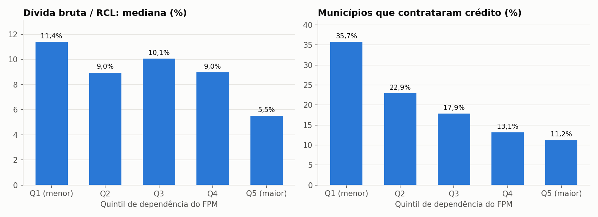
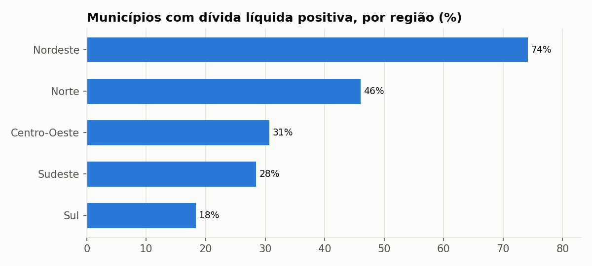
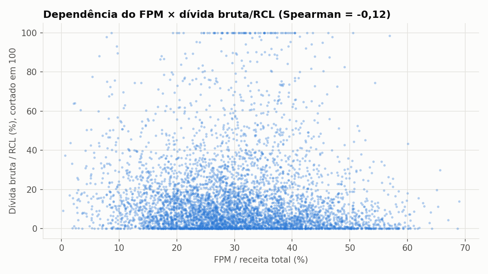
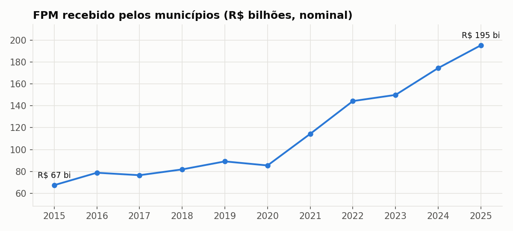
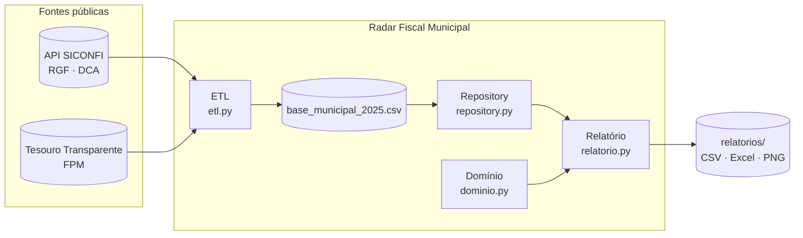
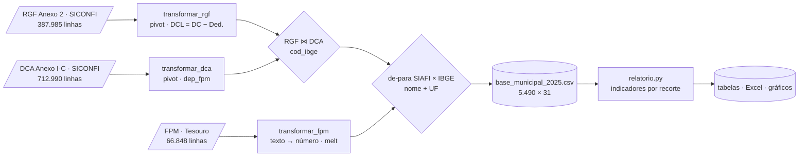

<div align="center">

# Radar Fiscal Municipal

**Análise de dados do endividamento e da dependência do FPM nos municípios brasileiros**


</div>

---

## Sumário

- [Sobre o projeto](#sobre-o-projeto)
- [Principais resultados](#principais-resultados)
- [Metodologia](#metodologia)
- [Indicadores](#indicadores)
- [Stack e ferramentas](#stack-e-ferramentas)
- [Arquitetura](#arquitetura)
- [Fluxo de dados](#fluxo-de-dados)
- [Dicionário de dados](#dicionário-de-dados)
- [Como rodar](#como-rodar)
- [Saídas da análise](#saídas-da-análise)
- [Uso como biblioteca](#uso-como-biblioteca)
- [Atualizar os dados (ETL)](#atualizar-os-dados-etl)
- [Testes](#testes)
- [Documentação](#documentação)
- [Estrutura de pastas](#estrutura-de-pastas)
- [Decisões técnicas](#decisões-técnicas)
- [Limitações](#limitações)
- [Próximos passos](#próximos-passos)
- [Como contribuir](#como-contribuir)
- [Referências](#referências)
- [Autor](#autor)

---

## Sobre o projeto

### Finalidade

O **Radar Fiscal Municipal** é um projeto de **análise de dados** que coleta, limpa e cruza três bases públicas
do Tesouro Nacional para investigar a relação entre a **dependência do FPM** e o **endividamento** dos municípios
brasileiros. O código é organizado como um pacote Python reprodutível: com um comando, qualquer pessoa refaz a
coleta, a integração dos dados, os indicadores, as tabelas e os gráficos.

### Contexto

O **FPM (Fundo de Participação dos Municípios)** é a principal receita da maioria das prefeituras. A
**Lei de Responsabilidade Fiscal** e a **Resolução do Senado nº 40/2001** limitam a **Dívida Consolidada
Líquida (DCL)** a **120% da Receita Corrente Líquida (RCL)**, com alerta a partir de **108%**.

### Pergunta e hipótese

> **Pergunta:** a dependência do FPM está associada ao nível de endividamento dos municípios?
>
> **Hipótese:** municípios **mais dependentes do FPM** têm **menor endividamento** (DCL/RCL), porque têm menos
> capacidade própria de pagamento e menos acesso a crédito.

### Escopo

- **Unidade de análise:** município (5.490 de 5.569; o DF fica de fora).
- **Período:** dívida e receitas de 31/12/2025 e série mensal do FPM de 2015 a 2025.
- **Origem:** projeto final da disciplina *Fundamentos de Programação Científica* (CST em Sistemas para
  Internet, IFTO, Campus Palmas).

---

## Principais resultados

| # | Achado | Evidência |
|---|---|---|
| 1 | A hipótese se confirma **só em parte** | Spearman dependência × dívida bruta/RCL = **−0,12** (fraca). O quintil mais dependente tem a menor dívida (DC/RCL mediana de 5,5%, contra 11,4% no menos dependente), mas os quintis Q2 a Q4 ficam parecidos |
| 2 | O **acesso a crédito** explica o mecanismo | Municípios que contrataram crédito em 2025: **35,7% (Q1) → 11,2% (Q5)**, em queda contínua |
| 3 | A **região** muda o resultado | Nordeste e Sudeste têm a mesma dependência (~31%), mas o Nordeste tem **74%** dos municípios com DCL positiva, contra **28%** no Sudeste. No Nordeste, a correlação é positiva (+0,10) |
| 4 | O endividamento excessivo é **localizado** | **57%** dos municípios têm caixa maior que a dívida. Só **42** (0,8%) passam do alerta de 108% e **31** (0,6%) do limite legal de 120% |
| 5 | O FPM nominal **quase triplicou** | De R$ 67 bi (2015) para R$ 195 bi (2025), o que ajuda a explicar a folga de caixa de 2025 |

**Dívida e crédito por quintil de dependência do FPM:** a dívida só cai de forma clara no quintil mais
dependente; já a contratação de crédito cai a cada quintil.



**Região:** com a mesma dependência do FPM, o Nordeste tem muito mais municípios endividados.



**Relação municipal:** nuvem dispersa, correlação negativa porém fraca.



**FPM ao longo do tempo:** quedas só em 2017 e 2020 e forte alta a partir de 2021.



A análise completa, com tabelas e interpretação, está em [notebooks/02_analise_indicadores.ipynb](notebooks/02_analise_indicadores.ipynb).

---

## Metodologia

1. **Coleta:** o RGF (Anexo 2) e a DCA (Anexo I-C) de 2025 vêm da API do SICONFI; a série mensal do FPM vem do Tesouro Transparente.
2. **Limpeza:**
   - conversão de valores em texto no padrão brasileiro;
   - exclusão do DF e de séries incompletas;
   - `pivot` das contas contábeis para uma linha por município.
3. **Validação:**
   - identidade contábil `DCL = DC − Deduções`, que fecha em 100% dos municípios;
   - `% DCL/RCL` recalculado igual ao informado;
   - razão FPM Tesouro/DCA de cerca de 0,82 em todos os municípios, o que confirma o de-para.
4. **Integração:** RGF × DCA pelo código IBGE; × FPM pelo de-para SIAFI ↔ IBGE (nome normalizado + UF + 22 correções manuais).
5. **Segmentação:** região, porte (faixas de população) e **quintis de dependência** (`pd.qcut`).
6. **Indicadores:** I1 a I4 calculados para o Brasil e para cada recorte (ver abaixo).
7. **Estatística:** a **mediana** é a medida central e a correlação usada é a de **Spearman**, ambas resistentes aos
   valores extremos autodeclarados (DCL/RCL chega a 1.333%).
8. **Desempenho:** no notebook, filtrar antes do `merge` foi 8 a 13 vezes mais rápido do que filtrar depois. O
   pipeline segue essa regra.

---

## Indicadores

| Código | Nome no código | Métricas | Fórmula |
|---|---|---|---|
| **I1** | `dependencia` | `mediana_pct`, `municipios_alta_dependencia_pct` | `dep_fpm = FPM (DCA) / receita total`; alta = `dep_fpm ≥ 0,40` |
| **I2** | `divida` | medianas de DCL/RCL e DC/RCL; % com DCL > 0; % ≥ 108%; % > 120% | `pct_dcl_rcl` (RGF) e `dc_rcl = DC / RCL × 100` |
| **I3** | `credito` | % com operação de crédito; crédito/receita do grupo | `Σ op_credito / Σ receita_total × 100` |
| **I4** | `correlacao` | Spearman dependência × DC/RCL e × DCL/RCL | Pearson entre os postos (ranks); negativo apoia a hipótese |

Cada indicador é uma função `DataFrame -> dict` registrada em `dominio.INDICADORES` e serve para qualquer recorte.
Para criar um indicador novo, basta escrever a função e registrá-la.

---

## Stack e ferramentas

| Área | Tecnologia | Uso |
|---|---|---|
| Linguagem | **Python 3.9+** | Todo o projeto |
| Manipulação de dados | **pandas**, NumPy | Limpeza, `pivot`/`melt`, `merge`, `groupby`, `qcut`, correlação |
| Visualização | **Matplotlib** | Gráficos do relatório |
| Exportação | **openpyxl** | Relatório em Excel (uma aba por tabela) |
| Exploração | **Jupyter** / Google Colab | Notebooks de exploração e análise |
| Coleta | `urllib` + `ThreadPoolExecutor` (biblioteca padrão) | Requisições paralelas à API do SICONFI |
| Configuração | **pydantic-settings** + `.env` | Parâmetros fora do código |
| Testes | **pytest** | Validação dos resultados da análise |
| Diagramas | **Mermaid** | C4, UML, ETL e ER, versionados junto com o código |
| Empacotamento | `pyproject.toml` (setuptools) | Instalação com `pip install -e .` |

---

## Arquitetura

O projeto é organizado **em camadas**: as dependências apontam para dentro e o domínio (regras e indicadores)
não depende de nenhuma outra camada. Os diagramas completos (C4, camadas, classes UML, sequência, ETL e ER)
estão em [docs/arquitetura.md](docs/arquitetura.md).



| Camada | Módulo | Responsabilidade |
|---|---|---|
| Configuração | `config.py` | Lê o `.env` e define caminhos e parâmetros |
| Domínio | `dominio.py` | Limites legais, classificações (região, porte, quintil) e indicadores. Funções puras, sem I/O |
| Dados | `etl.py` | Extract (SICONFI e Tesouro), Transform (pandas) e Load (CSV) |
| Acesso a dados | `repository.py` | Carrega e filtra a base. É o único módulo que sabe onde os dados estão |
| Saída | `relatorio.py` | Tabelas consolidadas, Excel e gráficos |

### Design patterns

| Padrão | Onde | Benefício |
|---|---|---|
| **Repository** | `MunicipioRepository` | Análises, testes e notebooks não conhecem o armazenamento; trocar o CSV por um banco muda só essa classe |
| **Strategy + Registry** | `dominio.INDICADORES`, `extrair_rgf` / `extrair_dca` | Indicadores e extratores intercambiáveis; um indicador novo entra em todas as tabelas quando é registrado |
| **Pipeline (ETL)** | `etl.executar` | Etapas pequenas, isoladas e testáveis |
| **Singleton via cache** | `@lru_cache` em `get_settings` | Configuração lida uma única vez |

---

## Fluxo de dados



| Etapa | Entrada | Saída | Comando |
|---|---|---|---|
| ETL | FPM (CSV), RGF e DCA (API) | `data/processed/base_municipal_2025.csv` | `python -m endividamento.etl` |
| Relatório | base processada | `relatorios/` (CSV, Excel, PNG) | `python -m endividamento.relatorio` |
| Exploração | dados brutos | análise comentada | `notebooks/*.ipynb` |

---

## Dicionário de dados

Tabela `base_municipal_2025.csv`: uma linha por município.

| Coluna | Tipo | Descrição | Fonte |
|---|---|---|---|
| `cod_ibge` | int | Código IBGE do município (chave primária) | SICONFI |
| `cod_siafi` | int | Código SIAFI (chave do FPM) | Tesouro |
| `municipio`, `uf`, `regiao` | str | Nome, UF e região | SICONFI |
| `populacao` | int | População usada pelo SICONFI | RGF |
| `porte` | str | Faixa de população: `até 10 mil` … `> 500 mil` | calculado |
| `periodicidade` | str | RGF quadrimestral (`Q`) ou semestral (`S`) | RGF |
| `dc`, `deducoes`, `dcl` | float | Dívida Consolidada, deduções e DCL (R$) | RGF |
| `rcl` | float | RCL ajustada para os limites de endividamento (R$) | RGF |
| `pct_dcl_rcl` | float | DCL / RCL (%) | RGF |
| `dc_rcl` | float | Dívida bruta / RCL (%) | calculado |
| `receita_total`, `impostos` | float | Receita total e impostos, taxas e contribuições (R$) | DCA |
| `fpm_dca` | float | FPM bruto declarado (R$) | DCA |
| `op_credito` | float | Operações de crédito do ano (R$; ausente = 0) | DCA |
| `dep_fpm` | float | FPM / receita total (0 a 1) | calculado |
| `quintil_dep` | str | `Q1 (menor)` … `Q5 (maior)` dependência | calculado |
| `fpm_2015` … `fpm_2025` | float | FPM líquido recebido no ano (R$ nominais) | Tesouro |

---

## Como rodar

### Pré-requisitos

- Python **3.9 ou superior**
- `git` e `pip`

### Instalação

```bash
git clone https://github.com/marcosguida/endividamento-municipal.git
cd endividamento-municipal

python -m venv .venv
source .venv/bin/activate            # Windows: .venv\Scripts\activate

pip install -e ".[dev]"              # pacote + testes
# pip install -e ".[dev,notebooks]"  # + Jupyter
```

### Configuração (opcional)

```bash
cp .env.example .env
```

| Variável | Padrão | Descrição |
|---|---|---|
| `ANO` | `2025` | Exercício de referência (define o arquivo da base) |
| `DATA_DIR` | `./data` | Pasta de dados |
| `SAIDA_DIR` | `./relatorios` | Pasta das tabelas e gráficos gerados |
| `SICONFI_API_URL` | `https://apidatalake.tesouro.gov.br/ords/siconfi/tt/` | URL da API do SICONFI |
| `SICONFI_WORKERS` | `4` | Requisições paralelas no ETL |

O `.env` é ignorado pelo git. Credenciais adicionadas no futuro devem ficar só nele.

### Gerar o relatório

```bash
python -m endividamento.relatorio
```

A base processada já vem no repositório, então o relatório roda na hora, sem refazer a coleta.

### Abrir os notebooks

```bash
jupyter notebook notebooks/
```

---

## Saídas da análise

Todas ficam em [relatorios/](relatorios/) e são regeneradas pelo comando acima.

| Arquivo | Conteúdo |
|---|---|
| `tabelas/por_regiao.csv` | Indicadores I1–I4 por região, mais a linha Brasil |
| `tabelas/por_quintil.csv` | Indicadores por quintil de dependência do FPM |
| `tabelas/por_porte.csv` | Indicadores por faixa de população |
| `tabelas/regiao_x_porte_dc_rcl.csv` | Mediana da dívida bruta/RCL por região × porte |
| `tabelas/lista_alerta.csv` | Municípios com DCL/RCL ≥ 108% |
| `tabelas/serie_fpm.csv` | FPM total por ano e variação anual |
| `relatorio_endividamento_2025.xlsx` | Todas as tabelas acima, uma por aba |
| `figuras/*.png` | Os 4 gráficos mostrados nos resultados |

---

## Uso como biblioteca

O pacote também pode ser usado em notebooks ou scripts para fazer outros recortes:

```python
from endividamento.config import get_settings
from endividamento.dominio import resumo, resumo_por
from endividamento.repository import MunicipioRepository

repo = MunicipioRepository.from_csv(get_settings().arquivo_base)

# Municípios do Tocantins muito dependentes do FPM
to = repo.filtrar(uf=['TO'], dep_fpm_min=0.4)

# Indicadores de dívida e crédito desse recorte
resumo(to, ['divida', 'credito'])

# Indicadores do Nordeste por porte
resumo_por(repo.filtrar(regiao=['Nordeste']), 'porte')

# Lista de alerta: DCL/RCL ≥ 108%
repo.filtrar(pct_dcl_rcl_min=108).sort_values('pct_dcl_rcl', ascending=False)
```

Filtros disponíveis em `filtrar()`, todos combináveis: `uf`, `regiao`, `porte`, `quintil`, `nome` (sem
diferenciar acentos), `dep_fpm_min/max`, `pct_dcl_rcl_min/max` e `populacao_min/max`.

---

## Atualizar os dados (ETL)

1. Baixe `fpm-por-municipio.csv` em
   [Tesouro Transparente, Transferências a Estados e Municípios](https://www.tesourotransparente.gov.br/temas/estados-e-municipios/transferencias-a-estados-e-municipios)
   e salve em `data/raw/`.
2. Ajuste `ANO` no `.env`, se quiser outro exercício.
3. Rode:

```bash
python -m endividamento.etl        # coleta e integra a base
python -m endividamento.relatorio  # refaz tabelas e gráficos
```

O RGF e a DCA são baixados da API do SICONFI para cerca de 5.570 municípios. A carga completa leva
algumas horas por causa do limite de requisições da API. O cache em `data/raw/` permite retomar uma
execução interrompida.

---

## Testes

```bash
pytest -v
```

Os testes (`tests/test_analise.py`) recalculam a análise e comparam o resultado com os números do notebook:

| Teste | Verifica |
|---|---|
| `test_base_carregada` | Base com 5.490 municípios |
| `test_filtros` | Região Norte (421), lista de alerta (42), busca sem acento e municípios pequenos endividados (167) |
| `test_normalizar` | Normalização de nomes usada no de-para |
| `test_indicadores_brasil` | Mediana da dependência (29,4%), DCL positiva (42,5%) e Spearman (−0,12) |
| `test_gradiente_de_credito_por_quintil` | Queda contínua do crédito de 35,7% (Q1) a 11,2% (Q5) |
| `test_serie_fpm` | Série anual de 2015 a 2025 |
| `test_relatorio_gera_arquivos` | Geração das 6 tabelas, do Excel e dos 4 gráficos |

---

## Documentação

| Recurso | Onde |
|---|---|
| Diagramas de arquitetura (C4, UML, ETL, ER) | [docs/arquitetura.md](docs/arquitetura.md) |
| Metadados das transferências do FPM | [docs/metadados_transferencias_por_municipio.pdf](docs/metadados_transferencias_por_municipio.pdf) |
| Exploração, qualidade e seleção dos dados | [notebooks/01_exploracao_e_selecao.ipynb](notebooks/01_exploracao_e_selecao.ipynb) |
| Análise, indicadores e interpretação | [notebooks/02_analise_indicadores.ipynb](notebooks/02_analise_indicadores.ipynb) |
| Tabelas e gráficos gerados | [relatorios/](relatorios/) |

---

## Estrutura de pastas

```
.
├── endividamento/              # pacote Python
│   ├── __init__.py
│   ├── config.py               # Settings (.env)
│   ├── dominio.py              # regras da LRF, classificações e indicadores
│   ├── etl.py                  # pipeline Extract → Transform → Load
│   ├── repository.py           # acesso e filtros sobre a base
│   └── relatorio.py            # tabelas, Excel e gráficos
├── data/
│   ├── processed/              # base integrada (versionada)
│   └── raw/                    # dados brutos e cache do ETL (fora do git)
├── relatorios/                 # saídas da análise (tabelas, Excel, figuras)
├── notebooks/                  # exploração e análise em Jupyter
├── docs/                       # diagramas e metadados
├── tests/                      # testes da análise
├── .env.example                # modelo de configuração
├── pyproject.toml              # dependências e empacotamento
└── README.md
```

---

## Decisões técnicas

- **Base processada versionada:** quem clona o repositório reproduz a análise na hora, sem esperar horas de coleta.
  Os dados brutos (cerca de 125 MB) ficam fora do git e podem ser baixados de novo.
- **CSV em vez de banco de dados:** a base tem 5,5 mil linhas (1,7 MB) e cabe em memória. O Repository isola essa
  escolha.
- **Mediana e Spearman:** resistentes a erros de preenchimento autodeclarados no SICONFI.
- **FPM da DCA para a dependência:** o Tesouro informa o FPM líquido (sem o FUNDEB) e a DCA informa o bruto. A
  série do Tesouro é usada só para a evolução no tempo.
- **Ausente = zero:** vale para `dc`, `deducoes` e `op_credito`, porque o SICONFI omite contas sem valor. Para a
  dívida, isso foi validado pela identidade contábil.
- **Gráficos com uma medida por eixo:** duas medidas de escalas diferentes viram dois gráficos lado a lado, nunca
  um eixo duplo.

---

## Limitações

- **Dados autodeclarados:** valores como 1.333% de DCL/RCL indicam erro de preenchimento no SICONFI.
- **Retrato de um ano:** a análise mostra associação, não causalidade, e o porte do município, variável de
  confusão, ainda não foi controlado.
- **Valores nominais:** o FPM não foi corrigido pela inflação.
- **Cobertura:** 79 municípios ficam de fora (34 só entregaram o RGF, 15 só a DCA, 29 nenhum dos dois e
  1 não tem série de FPM), além do DF.
- **De-para por nome:** depende de 22 correções manuais, validadas pela razão Tesouro/DCA.

---

## Próximos passos

- [ ] Série histórica da dívida (vários exercícios) para análise temporal
- [ ] Controle por porte e PIB per capita (dados do IBGE) em um modelo de regressão
- [ ] Correção monetária do FPM (IPCA)
- [ ] Mapa coroplético da dívida por município
- [ ] CI com GitHub Actions rodando o `pytest`

---

## Como contribuir

1. Faça um fork do repositório.
2. Crie uma branch: `git checkout -b feat/minha-analise`.
3. Faça os commits no padrão [Conventional Commits](https://www.conventionalcommits.org/pt-br/), por exemplo
   `feat(dominio): adiciona indicador X`.
4. Rode `pytest` antes de abrir o pull request.
5. Abra um pull request explicando o que mudou e por quê.

---

## Referências

- [Lei Complementar nº 101/2000 (Lei de Responsabilidade Fiscal)](https://www.planalto.gov.br/ccivil_03/leis/lcp/lcp101.htm)
- Resolução do Senado Federal nº 40/2001: limites da dívida consolidada
- [API de dados abertos do SICONFI](https://apidatalake.tesouro.gov.br/docs/siconfi/)
- [Tesouro Transparente: transferências a estados e municípios](https://www.tesourotransparente.gov.br/temas/estados-e-municipios/transferencias-a-estados-e-municipios)
- [Documentação do pandas](https://pandas.pydata.org/docs/) · [Documentação do Matplotlib](https://matplotlib.org/stable/)

---

## Autor

**Marcos Ribeiro Guida**
Estudante de CST em Sistemas para Internet, IFTO, Campus Palmas

[](https://github.com/marcosguida)

---

<sub>Dados públicos do Tesouro Nacional (SICONFI e Tesouro Transparente). Os resultados dependem da qualidade
das informações declaradas pelos municípios.</sub>
