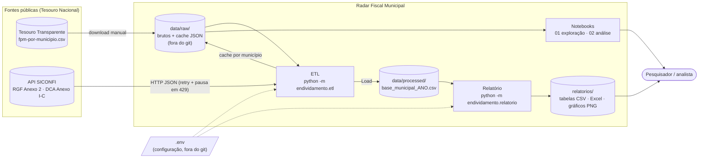
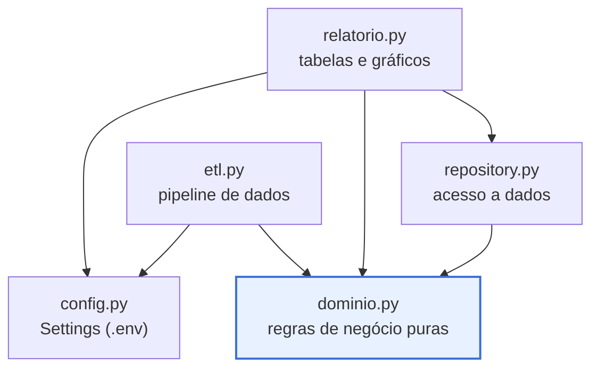
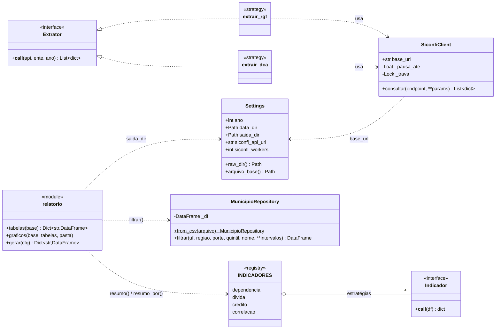
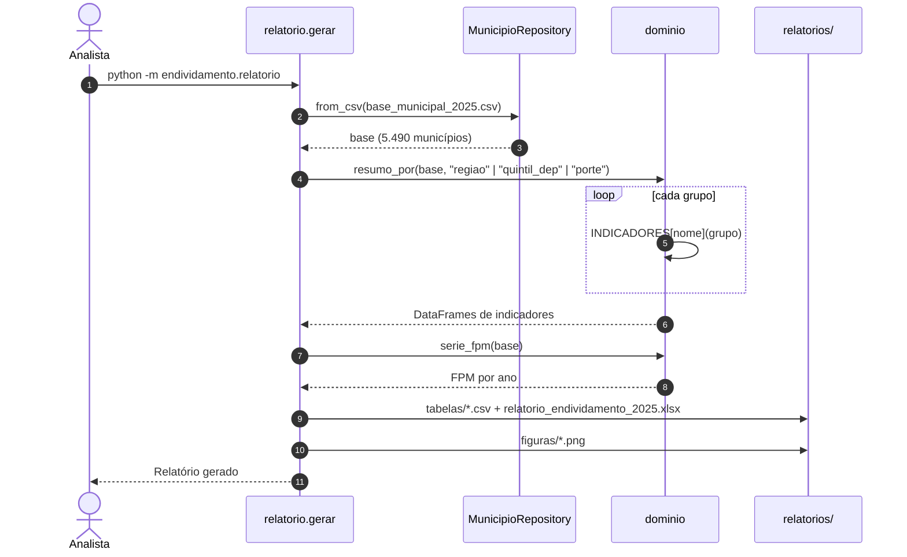
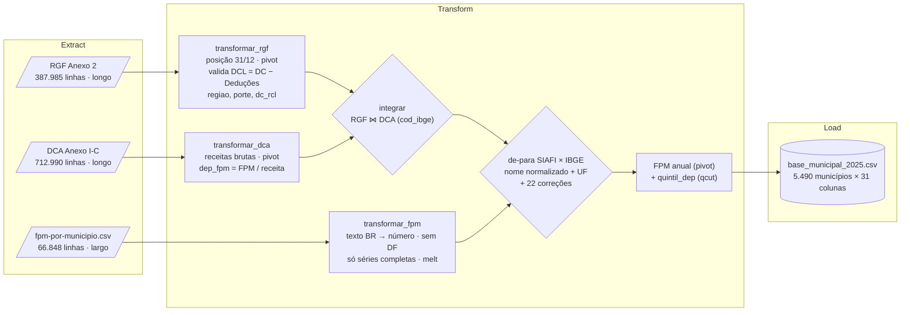
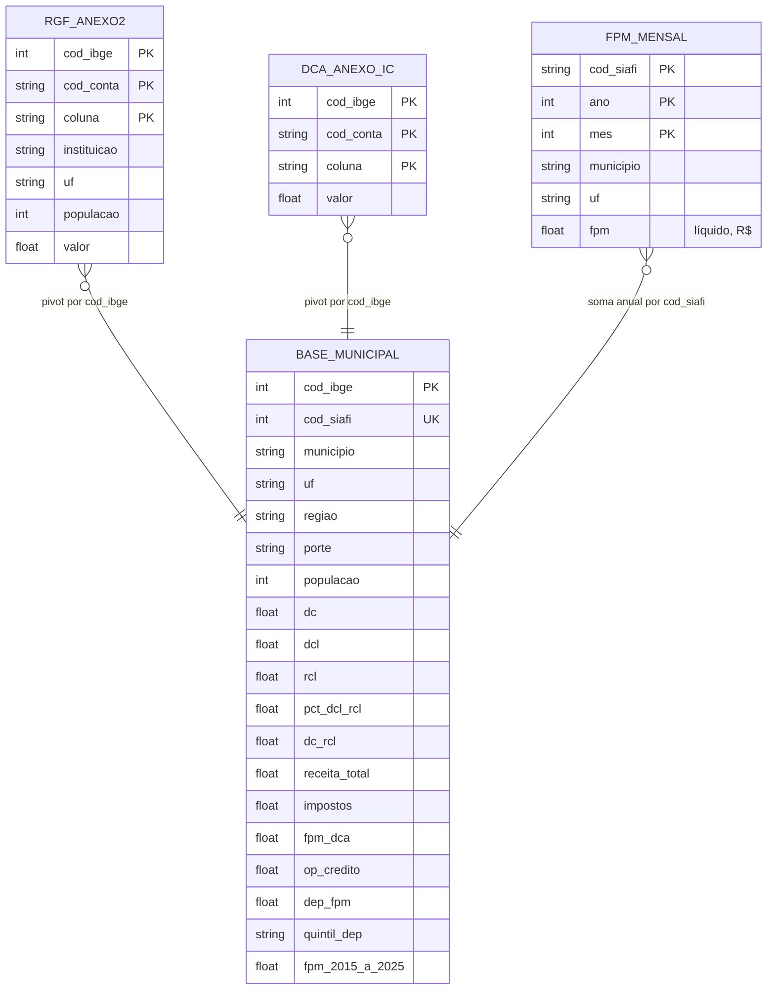

# Arquitetura e modelagem

Diagramas em [Mermaid](https://mermaid.js.org/), renderizados pelo próprio GitHub. Notação: C4 (contexto),
UML (classes e sequência) e modelo entidade-relacionamento (dados).

## 1. Contexto (C4)

De onde vêm os dados, o que o projeto produz e quem consome.

## 2. Camadas e dependências entre módulos

Cada seta é um `import`. O domínio não depende de nenhuma outra camada.

## 3. Diagrama de classes (UML)

## 4. Sequência: geração do relatório

## 5. Pipeline ETL

## 6. Modelo de dados (ER)

